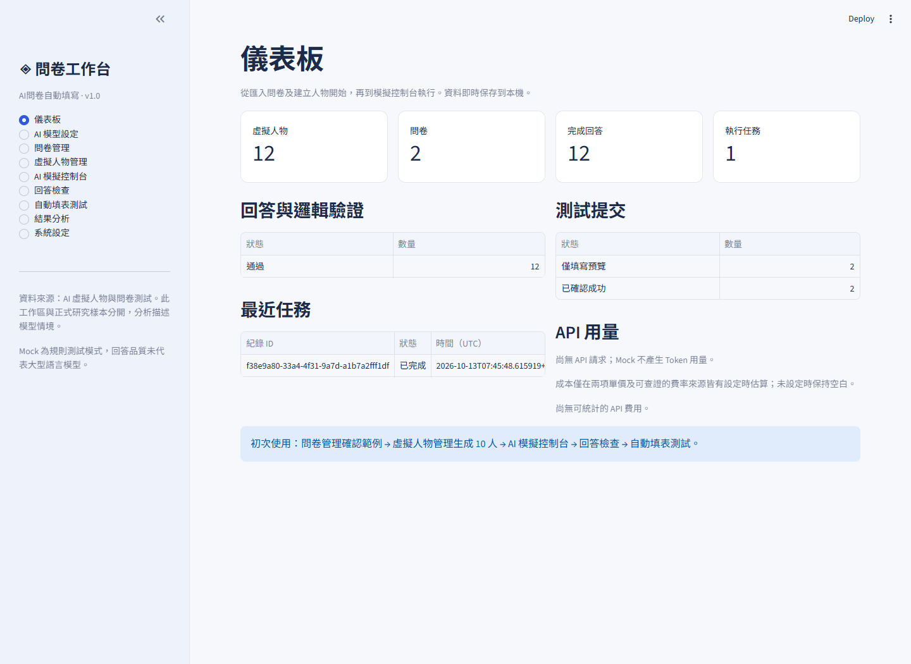

# AI-Respondent-Studio · AI問卷自動填寫

可在 Windows 本機操作的 AI 虛擬受訪者、問卷模擬與授權表單測試工具。核心流程已實作：**建立人物 → 逐頁回答 → 邏輯驗證 → SQLite 儲存 → Playwright 填表與確認收件**。

無 API Key 也能使用 Mock 完成整個流程。Mock 採情境相關的規則，供功能測試，不能代表大型語言模型的回答品質。人物比例、偏好及圖表均描述使用者設定的模型情境，不能推論真實人群。



## 從 GitHub 下載

1. 在 GitHub 儲存庫按 **Code → Download ZIP**，將檔案完整解壓縮。
2. 安裝 Python 3.11 或以上，雙擊資料夾中的 **`start.bat`** 或 **`啟動系統.bat`**。
3. 首次會安裝套件並建立本機資料庫，接著開啟網頁介面；沒有 API Key 也可使用 Mock。

GitHub 不含本機資料庫、API 金鑰及 `.venv`。範例人物可在人物管理匯入 `examples/personas.json`；已完成的 12 人示範匯出在 `outputs/demo/`。若要在新的本機資料庫重建完整示範，可執行 `.\.venv\Scripts\python.exe -m survey_sim.cli demo --count 12 --browser`。

## 初次啟動

1. 在這台已完成安裝的電腦，雙擊 **`start.bat`**（亦提供 `啟動系統.bat`）。
2. 等待本機網頁開啟，預設網址是 **http://127.0.0.1:8501**。
3. 第一次開啟會有 ONLYFRAME 及數位服務兩份可操作的測試問卷。交付的本機資料庫另包含已實際執行的 12 位示範人物及結果。
4. 保留啟動視窗；關閉它會停止服務。重新啟動後，資料仍在 `data/simulator.sqlite3`。

其他電腦需安裝 [Python 3.11 或以上](https://www.python.org/downloads/windows/)，勾選 Add Python to PATH，然後雙擊 `start.bat`。首次會建立獨立 `.venv` 並安裝 requirements。腳本會略過不可用的 WindowsApps Python 別名，也能使用 Python Launcher 或設定 `PYTHON_EXE`。

瀏覽器自動化優先使用已安裝的 Chrome / Edge；若沒有，雙擊 `install-browser.bat` / `安裝瀏覽器.bat` 安裝 Playwright Chromium。日常操作皆在網頁完成，不需修改 Python 程式。

若連接埠占用，可將 `.env.example` 複製為 `.env`，修改 `APP_PORT` 或 `MOCK_FORM_PORT`。`.env` 不加入版本控制，API Key 欄位可保持空白。

## 第一次完整操作

1. **AI 模型設定**：先選 Mock 設定檔；可測試連線或建立其他廠商的設定檔。
2. **問卷管理**：選 ONLYFRAME 功能測試問卷，查看題目、頁面及分流。範例已確認；自行匯入的問卷需逐題核對後確認。
3. **虛擬人物管理**：選主題、人物數量、seed、人設類型或比例，按「生成並儲存人物」。可查看及編輯每位人物。
4. **AI 模擬控制台**：選問卷、人物與回答模式，先預覽人物，按「建立批次任務」，再按「開始 / 繼續」。
5. **回答檢查**：查看答案、每題簡短決策依據、跳題路徑與驗證結果。
6. **自動填表測試**：選已完成回答，建立本地 Mock Form；再從表單選單選取保存的本地表單。執行 Dry Run 觀察預覽，再執行授權測試提交。
7. **結果分析**：看選項分布、量表平均、人物分組、分流與人物相似度；按「準備 CSV、Excel、JSON 匯出」下載。

## 九個操作頁面

| 頁面 | 可執行功能 |
|---|---|
| 儀表板 | 人物、問卷、完成回答、任務、驗證、提交及 API 用量 |
| AI 模型設定 | 多設定檔、切換 provider、Key、Base URL、模型、溫度、Token、逾時、重試、連線測試、手動費率 |
| 問卷管理 | 手動建立、JSON / CSV / Google 公開 DOM 草稿匯入、題型編輯、選項及列、頁面、分流、顯示條件、網頁對應、語意分析、人工確認 |
| 虛擬人物管理 | 兩階段生成、類型比例、逐人即時儲存、完整預覽、人格滑桿、背景 / 預算編輯、進階 JSON、複製、刪除、人物匯入 |
| AI 模擬控制台 | 任務快照、人物預覽、逐頁回答、即時進度、開始、暫停、停止、繼續、失敗項目重試、紀錄 |
| 回答檢查 | 最終答案、理由、格式驗證、分流略過、人工檢查、自動重試歷程 |
| 自動填表測試 | 本地表單、授權外部表單、精確 URL Allowlist、動作預覽、Dry Run、提交、成功標記確認、截圖、未知狀態人工查證 |
| 結果分析 | Plotly 圖表、量表平均、背景與人設分組、組合集中度、分流及人格相似度 |
| 系統設定 | 資料集來源、SQLite 備份、完整資料匯出、除錯日誌 |

## 人設與回答方式

生成人設先建立成年人物的背景與生活情境，再根據背景推導心理特徵、核心價值觀及行為。主題延伸資訊存於 `topic_attributes`；金融、服務、教育及產品問卷皆可使用，沒有固定成收藏者。

價格、品質、外觀、品牌、風險、衝動、理性、社群、個人化與新事物接受程度均為 0–1。Mock 使用相關的潛在生活因素及合理例外；真實 AI Adapter 將背景與完整 schema 交給模型產生並驗證，背景在第二階段不得改變。

人物比例以最大餘數法分配完整人數，再按 seed 打亂順序。生成時檢查近 100 位的人設相似度，高度相似會有限重生；分析頁提供前 100 位完成者的相似矩陣。相似度是工程檢查指標，不是心理計量量尺。無法保證大批人物永不相似或答案永不重複。

Mock 的同 seed / 設定可重現。真實 API 受服務、模型版本及抽樣影響，不保證完全重現；人物、問卷、模型及回答模式快照仍可追溯。人物修改會增加修訂版，歷史回答保留當時快照。

引擎每頁提供同一人物、整份問卷、語意註記與先前答案，採結構化輸出及本地驗證。高一致性、自然變動與自訂變動均保留合法選項，不以故意答錯製造自然感。對長問卷，逐頁保存 checkpoint，避免要求一次輸出過長的答案。

## AI Provider 設定

| 服務商 | 實作協定 | Base URL 預設 |
|---|---|---|
| OpenAI | Chat Completions，Bearer，`max_completion_tokens` / 可切換 `max_tokens` | `https://api.openai.com/v1` |
| DeepSeek | 官方 OpenAI 相容 Chat Completions，`max_tokens` | `https://api.deepseek.com` |
| Gemini | 原生 `generateContent`、`systemInstruction`、`generationConfig`，`x-goog-api-key` | `https://generativelanguage.googleapis.com/v1beta` |
| Claude | 原生 Messages、獨立 `system`、`x-api-key`、`anthropic-version` | `https://api.anthropic.com` |
| Ollama | 原生 `/api/chat`、`stream=false`、`options`、`format=json` | `http://localhost:11434` |
| 相容 API | 可設定 Base URL 的 Chat Completions | 由使用者填寫 |

模型名稱手動填入帳戶可用名稱，不假定每家 API 或參數相同。Claude 採提示要求 JSON 並在本地驗證，不送 OpenAI 的 `response_format`。有些模型不接受溫度、JSON 模式或特定 Token 欄位；在介面停用 / 切換相關設定。收到 400 會顯示參數說明，不會暗中換模型。

401、403、402、404、429、5xx、Timeout、無效 JSON 及輸出截斷皆有可讀錯誤。網路、429 及 5xx 採有限退避；`Retry-After` 數字值上限 30 秒。格式不合法的頁面最多修復兩次，持續失敗後保存前面頁面並標記失敗人物。

API 請求設有最短間隔，人物之間另可設定間隔；批次為單一 worker。不同瀏覽器工作階段手動觸發的 API 操作不具全域服務商限速，仍需按帳戶配額合理設定。

金鑰預設只存在本次工作階段。可選 Windows 認證管理員保存；失敗會明確告知，不會退回明文檔。也可自行在 `.env` 設定官方環境變數。ProviderConfig、SQLite、匯出檔不含金鑰；日誌對已登記金鑰及認證標頭做遮罩。清除 UI 保存金鑰不會修改使用者的 `.env`。

API Token 使用量採服務回應計數；無計數時留空。費用必須同時填輸入 / 輸出單價、幣別及可查證來源 / 日期才估算；不內建未經核對的費率，亦非帳單總額。Mock 不產生虛構 Token 或費用。

## 問卷匯入與結構

範例檔案在 `examples/`：

- `onlyframe_questionnaire.json`：17 題、三頁、條件顯示、多頁分流、全部支援題型。
- `general_questionnaire.json`：數位服務主題，展示正向與反向註記。
- `questions.csv`：最小可操作的 CSV 範例。
- `personas.json`：8 位完整、可編輯及匯入的人物。

**ONLYFRAME 範例僅為功能測試，並非使用者的正式研究問卷或經驗證研究量表。**真正問卷可另行匯入。

題型 ID：`single`、`multiple`、`dropdown`、`short_text`、`paragraph`、`linear_scale`、`likert`、`single_grid`、`checkbox_grid`。特殊題型用 `unsupported` 保留並顯示警告；修正前不可確認。

JSON 基本結構如下（完整欄位可直接下載範例，不需寫 Python）：

```json
{
  "id": "my-test",
  "title": "服務測試問卷",
  "topic": "數位服務",
  "purpose": "test",
  "pages": [{
    "id": "P1",
    "title": "第一頁",
    "questions": [{
      "id": "Q01",
      "title": "您是否使用此服務？",
      "type": "single",
      "required": true,
      "options": [{"id":"yes","label":"是"},{"id":"no","label":"否"}]
    }]
  }]
}
```

CSV 至少需 `id,title,type`。選填欄位包含 `required,options,rows,page_id,page_title,scale_min,scale_max,min_choices,max_choices,max_length,concept,trait,reverse,persona_field,display_if,routes,default_next,binding`。選項可以 `價格|品質|品牌`，或以 CSV 引號包住 JSON 陣列。方格列、條件、分流與對應欄位使用 JSON；以同頁第一列的 routes/default_next 定義頁面規則。

題目 ID 固定，選項及方格列亦使用 ID，畫面文字改變不會靠順序猜測。頁面條件按順序採第一個符合規則；`default_next` 空白則依頁序。跳頁僅允許向後頁面或 `END`，不支援循環問卷。條件運算有 `eq,ne,includes,gt,gte,lt,lte`，顯示條件全部成立才出現。

Google Forms 採公開 DOM 草稿匯入，**不是官方完整表單 API**。只辨識當前頁面可讀的單選、多選、文字；方格、下拉、線性量表等不確定型態須人工修正。Google 登入、驗證碼、關閉表單或無法唯一對應會停止。後續頁面、分流、特殊驗證及選項完整性不會自動當作已確認。Google 官方 Forms API 讀取需授權，這版沒有替使用者繞過授權。

介面提供題目 / 頁面 / 分流選單、選項編輯與完整 JSON 編輯。Google 自動化可使用題目標題或容器 CSS selector、選項文字覆寫及方格列 selector；必須人工核對與 Dry Run，網站結構改變時需更新對應。

## 邏輯驗證與批次恢復

驗證分為通過、人工檢查與明確錯誤。格式、必填、選項 ID、量表範圍、方格列、重複題目與分流外回答屬明確錯誤。明確註記的文字人物欄位（如年齡、職業）須一致。

人格與量表差距過大、缺少決策依據、主題預算超過每月可支配金額或指定跨題規則出現差異，標記人工檢查。喜歡個人化但不願多付費不直接視為矛盾。這版不宣稱能自動辨識任意領域所有心理矛盾；研究者應核對語意分析及人工檢查項目。

可在 JSON 的 `consistency_rules` 設定 `{left,right,relation,tolerance,explanation}`，relation 為 `same` 或 `reverse`；系統保留差異作人工檢查，不直接推定態度錯誤。

任務保存完整快照、逐人狀態、頁面 checkpoint、嘗試次數及事件。暫停 / 停止會讓目前 HTTP 請求在逾時設定內結束，保存完成頁面後停下；已完成人物不重新生成。重啟後中斷任務變為暫停，點繼續恢復。失敗重試只重排 `failed` 項目；有已保存的明確錯誤結果可調整問卷或人物後建立新任務。

同一資料庫請只開一個服務實例；不要在 UI 批次仍執行時對相同資料庫跑 CLI demo 或啟動第二份程式。

## 授權表單測試

每個表單目標保存用途、問卷 ID、授權狀態與成功判定。正式研究參考問卷可以離線模擬，但禁止送入原正式表單；如需測試，使用獨立測試複本與測試 URL。

URL Allowlist 精確比對完整網址，不使用網域萬用字元。移除查詢參數及片段；Google 請使用展開的 `docs.google.com/forms/.../viewform`。Dry Run 填寫及保存截圖，不按提交；真實提交必須明確確認測試授權並設定提交後才出現的成功元素 / 文字。瀏覽器主頁導覽限制於指定頁面及 Google 該表單提交頁，不前往登入或其他未授權主頁。

本地表單涵蓋多頁、分流、必填、多選限制與兩種方格。伺服器在收件端重新檢查格式及路徑，成功會保存唯一收件編號。自動化不只按提交，還會核對畫面收件編號與 SQLite 紀錄。收件 token 具有冪等保護，同份回答送相同本地表單不增加第二筆收件。

外部表單不能保證伺服器冪等。SQLite 會阻擋已成功、正在送出或狀態不明的同回答 / URL 組合。按提交後未能確認成功會記錄 `unknown`，需要使用者查看接收端紀錄，再在網頁保存「已收到」或「確定未收到」；不自動重送。系統不規避驗證碼、繞過存取限制或偽裝真人。

## 儲存、備份及匯出

資料庫在 `data/simulator.sqlite3`。主要資料表：workspace、entities（人物 / 問卷 / Provider / 測試表單）、tasks、task_items、responses、answers、usage、events、submissions、local_receipts。

資料集來源只在工作區 / 匯出層級記錄，不在每題反覆加標籤，也不要求 `synthetic=true`。本系統沒有匯入真實受訪者回答的功能，因此正式研究樣本需存於其他工作區或系統。

CSV ZIP、Excel、JSON 包含來源、人物、每份回答、每題理由、題目對照、執行紀錄、驗證、API 用量與提交紀錄。`persona_id`、`questionnaire_id`、`question_id`、`task_id`、`response_id` 及修訂資訊可關聯。工作區人物匯出包含歷史人物版本，以免刪除 / 修改人物後失去對照。多任務同一人物可以有多列回答，靠 task/response ID 區分。

CSV 採 UTF-8 BOM，Excel 有標題樣式、凍結列與篩選。多選 / 方格使用 JSON 保留 ID 結構。為避免開啟外部匯入文字時觸發試算表公式，`=,+,-,@` 起始字串在 CSV / Excel 加前置單引號；JSON 保留原始文字（已登記金鑰仍會遮罩）。

除錯日誌在 `data/logs/debug.log`，採大小輪替；截圖在 `data/artifacts/`。可在系統設定建立一致的 SQLite 備份。不要只在程式執行中複製主 `.sqlite3` 而漏掉 WAL；請使用備份按鈕，或關閉服務後複製整個 data 資料夾。

## 開發與測試

```powershell
.\.venv\Scripts\python.exe -m pytest --basetemp=.tmp\pytest
.\.venv\Scripts\python.exe -m survey_sim.cli examples
.\.venv\Scripts\python.exe -m survey_sim.cli demo --count 12 --browser
```

也可雙擊 `test.bat`。一般單元測試及介面測試不呼叫真實 API；Provider 使用 HTTP MockTransport 驗證各家 endpoint、標頭、payload、回應與用量。browser 標記的測試真的啟動 Chrome / Edge / Chromium 操作本地 HTTP 表單，沒有 Google 或第三方提交。

架構：`models` 資料契約、`providers` 廠商 Adapter、`mock_ai` 測試規則、`personas` 兩階段人物、`parsers` 匯入、`engine` 逐頁回答、`validator` 獨立驗證、`batch` 任務 worker、`storage` SQLite、`mock_form` 本地收件端、`automation` Playwright、`analysis` 統計及匯出、`ui_*` 繁中管理頁面。

不同模型可以用同一人物及問卷各建一個任務，回應快照包含 model/provider/usage，已保留模型比較需要的識別資訊。專用跨模型比較頁面為未來擴充，這版尚未實作。

實際驗收與未驗證功能請見 **`ACCEPTANCE.md`**；pytest 原始機器報告在 `outputs/pytest-results.xml`。

## 官方實作參考

以下文件在開發時查閱，廠商能力仍應按所選模型確認：

- [OpenAI Chat Completions](https://developers.openai.com/api/reference/resources/chat/subresources/completions/methods/create)
- [DeepSeek 官方 API 入口](https://api-docs.deepseek.com/)
- [Gemini generateContent](https://ai.google.dev/api/generate-content)
- [Claude Messages](https://platform.claude.com/docs/en/api/messages/create)
- [Ollama Chat](https://docs.ollama.com/api/chat)
- [Google Forms 官方讀取 API 與授權](https://developers.google.com/workspace/forms/api/guides/retrieve-forms-responses)
- [Playwright Python 安裝與瀏覽器](https://playwright.dev/python/docs/intro)
- [Streamlit fragment](https://docs.streamlit.io/develop/api-reference/execution-flow/st.fragment)
